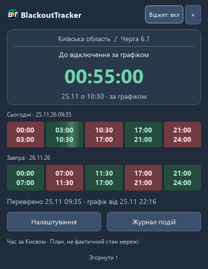
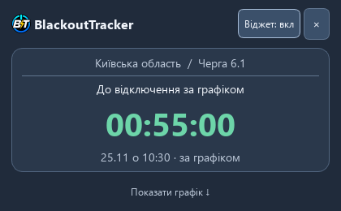

<p align="center">
  
</p>

<h1 align="center">BlackoutTracker</h1>

<p align="center"><strong>Знай, коли за графіком вимкнуть світло. Встигни підготуватися.</strong></p>

<p align="center">
  Графік відключень, таймер і попередження — поруч, у треї Windows.
  <br>Без встановлення та зайвих вкладок у браузері.
</p>

<p align="center">
  <a href="https://github.com/akoval29/BlackoutTracker/releases/latest"><strong>⬇ Завантажити для Windows</strong></a>
  &nbsp; · &nbsp;
  <a href="https://github.com/akoval29/BlackoutTracker/issues">Повідомити про проблему</a>
</p>

<p align="center">Windows 10 (1809+) / 11 · 64-bit · Portable · Український інтерфейс</p>

---

## Світло за розкладом — плани під контролем

BlackoutTracker показує, скільки часу залишилося до наступної події за графіком. Відкрий панель із трею, щоб побачити розклад на сьогодні й завтра, або залиш таймер на робочому столі.

<p align="center">
  
</p>

<p align="center"><sub>Справжній інтерфейс програми на демонстраційних даних. Це приклад, а не актуальний графік.</sub></p>

## Що вміє програма

| | |
| --- | --- |
| ⏱ **Відлік до події** | Час до відключення або повернення світла за графіком. |
| 🗓 **Графік під рукою** | Кольорові інтервали на сьогодні й завтра для твоєї черги. |
| 🔔 **Звукові попередження** | Нагадування за 5 та 10 хвилин — кожне можна ввімкнути окремо. |
| 🖥 **Віджет на робочому столі** | Прозорий таймер із вибором позиції та режимом поверх вікон. |
| 📝 **Журнал подій** | Історія змін графіка та сповіщення про екстрені відключення. |
| ⚙ **Працює у треї** | Автоматичне оновлення даних і запуск разом із Windows за бажанням. |

**Підтримувані регіони:** м. Київ, Київська, Одеська та Дніпропетровська області.

## Почни за хвилину

1. Відкрий [останній реліз](https://github.com/akoval29/BlackoutTracker/releases/latest) і завантаж ZIP **BlackoutTracker-…-win-x64.zip** у розділі **Assets**.
2. Розпакуй **всю папку** в зручне місце.
3. Запусти **Blackout tracker.exe** та обери регіон і чергу.

Готово! Python та інші залежності вже всередині. Інсталяція й права адміністратора не потрібні.

> Зберігай EXE разом із папкою `_internal`. Автоматичний архів GitHub **Source code** призначений для роботи з кодом — для запуску завантаж portable-збірку.

## Поруч, коли потрібно

<p align="center">
  
</p>

- **Натисни іконку в треї**, щоб відкрити панель. Хрестик сховає її назад.
- **Натисни картку таймера або «Показати графік»**, щоб розгорнути подробиці.
- **Увімкни віджет**, якщо хочеш бачити відлік на робочому столі.
- **Зазирни в налаштування**, щоб обрати звукові попередження, частоту оновлення й автозапуск.

> Графік показує **планові відключення, а не фактичний стан електромережі**. Усі години — за Києвом. Якщо дані застаріли, програма позначить це; для застарілих даних, можливих та екстрених відключень звукові попередження не запускаються.

## Як оновитися

Заверши програму через меню трею **«Вийти»**, розпакуй нову версію й перенеси папку `data` зі старої збірки в нову — так збережуться налаштування. Якщо змінив місце зберігання програми, повторно ввімкни автозапуск у налаштуваннях.

## Є ідея або щось не працює?

[Створи issue](https://github.com/akoval29/BlackoutTracker/issues) — додай регіон, чергу, версію програми та короткий опис. Скриншот допоможе швидше зрозуміти проблему.

<details>
<summary><strong>Для розробників</strong></summary>

Програма написана на Python із використанням PySide6 / Qt.

```powershell
python -m venv .venv
.venv\Scripts\python -m pip install -r requirements-build.txt
.venv\Scripts\python main.py
```

Перевірки та portable-збірка:

```powershell
.venv\Scripts\python -m unittest discover -s tests
.venv\Scripts\python -m tools.check_ui
powershell -ExecutionPolicy Bypass -File tools/build_portable.ps1
```

Докладні інструкції, структура коду та особливості роботи — у [README.txt](README.txt). Цей файл також постачається з portable-збіркою.

PySide6 / Qt використовуються як динамічні бібліотеки за LGPLv3. Ліцензії сторонніх компонентів — у [licenses](licenses).

</details>
